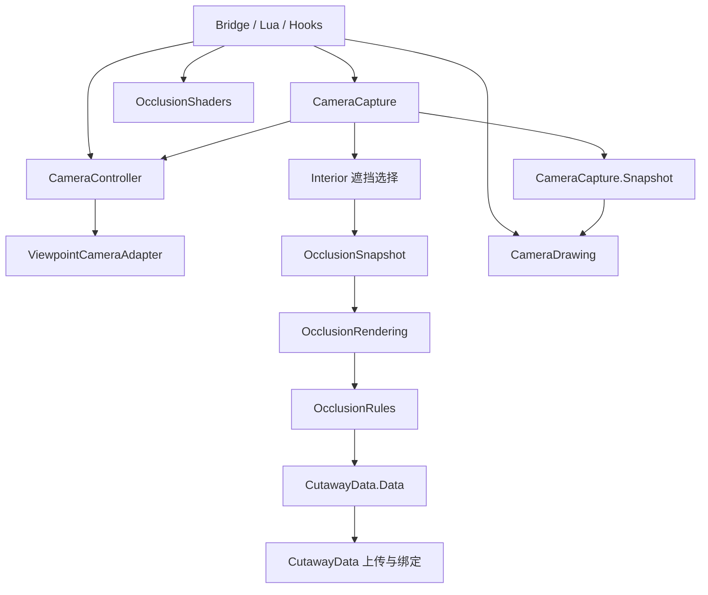

# 相机与遮挡分层

本分支从 `471d839` 开始渐进重构。本轮已完成相机状态、Viewpoint 适配、帧捕获、遮挡结果、规则打包、绘制上下文与着色器转换的分离。

## 职责与调用方向

| 模块 | 拥有的数据或职责 |
| --- | --- |
| Bridge | 保留 OldPointBridge Lua 名称、原有对外方法和 Hook 注解；把调用交给具体模块 |
| CameraController | OldPoint 模式、进入请求、记忆返回、保存视角、旋转输入和过渡 |
| ViewpointCameraAdapter | Viewpoint 私有启停方法、光标字段、步行/乘车第三人称设置；按需解析并缓存反射绑定 |
| CameraCapture | 当前帧相机几何，以及以 Frame 为弱键的同步快照表 |
| CameraDrawing | 绘制线程的相机快照绑定、方向/位置读取、居中矩阵和天气锚点 |
| ViewpointVisibilityAdapter | Viewpoint 房间可见性锚点与原生 portal culling 的兼容操作 |
| Interior | 遮挡选择、渐变进度、按 SceneData 发布结果，以及 CPU 端遮挡查询 |
| OcclusionSnapshot | 捕获结果的数据约定：房间轮廓、上层区域、墙体渐变、屋顶、开口、树和室内明暗 |
| OcclusionRules | 将捕获结果打包为 GPU 规则表，判断几何是否相同并复用打包结果；不调用 OpenGL |
| OcclusionRendering | 绘制线程的遮挡快照、内置/Iris uniform 上传，调用 CutawayData 上传与绑定 |
| OcclusionShaders | 内置/Iris 着色器文本转换，不访问帧状态或游戏世界 |
| CutawayData | 原有 GPU 缓冲、纹理与采样器绑定、恢复 |

普通业务方法直接访问 CameraController 或 CameraDrawing。标注 @Patch 的 Hook 方法体会被 ZombieBuddy 内联到 Viewpoint 或游戏包，必须通过 public 类和 public 方法调用；这些回调保留 Bridge 公开入口，不能直接调用包内可见的 Controller/Drawing。Interior 原有的 shader、uniforms、irisUniforms、begin/end 方法也保留委托，避免改动既有调用协议。



Viewpoint 继续拥有实际的 View.enabled、View.thirdPerson 和 Look。请求 FP.cycleView 不等于启用成功，仍由 afterToggle 确认并消费请求。适配层执行操作，转换策略和原有异常处理位置留在 Controller。

## 捕获与绘制的约定

CameraCapture 调用 CameraController.captureYaw 推进旋转，再计算当前帧几何。CameraCapture.Snapshot 保存不可变的相机偏移、方向及天气锚点；偏移字段命名为 offsetX/offsetUp/offsetZ，避免原先 x/up/y 混用轴的含义。

CameraDrawing 在 beginDrawing 绑定该帧快照，在 endDrawing 清除线程绑定。绘制期间读取快照，不推进旋转。绘制上下文之外的方向查询仍按原行为只读取 Controller 的当前朝向。centerDrawing 和 position 保留 Viewpoint Frame 内的 eye 坐标参与计算，未改变帧复用协议。

相机快照仍在 Interior.capture 之前发布。TreeClearing、Interior、相机效果清零、全局 View 偏移、cameraCut、Pointer、VisionSystem 和光标同步的先后顺序保持原样。普通视角或 frame.onCamera 路径覆盖旧的俯视快照，避免复用帧遗留标记。

遮挡结果继续按 SceneData 保存，不强行与相机的 Frame 快照合并。房间矩形、墙体段、开口实例、树遮罩和屋顶模型保留各自的表示与选择算法。OcclusionSnapshot 的 origin/player/direction/eye 使用 Viewpoint 渲染轴；矩形、墙体位置和 floor 使用游戏坐标。捕获端拥有列表和树的 cells 数组，消费端按只读约定使用，未在每帧新增深拷贝。

规则表仍限制为 32 个上层区域和 128 段结构墙。规则复用继续比较房间区域、边界、墙体渐变、屋顶、开口实例、室内明暗和树网格内容；单纯相机移动不重新打包。CPU 端遮挡查询保留原有 latest/scene 选择方式。

## 保持的行为与一处清理修复

- 循环键：第一人称 → 第三人称 → 俯视 → 第一人称。
- 记忆俯视键记住来源；退出时返回原版、第一或第三人称。
- Viewpoint 启用仍经过其正常检查，待处理请求保留原有 10 秒超时。
- 自动/瞄准请求保留原有 0..4 编码和各入口原本不同的守卫。
- FreeCam 临时使 topDownActive 为 false，不等同于退出俯视。
- 固定角度、拖动、分步旋转和朝向重置保持原有条件与顺序。
- 不修改遮挡选择算法、规则表布局、着色器转换结果和 Hook 执行顺序。

绘制异常的清理有一处明确增强：TreeClearing.end 抛错后仍执行 Interior.end 和 RoofModels.end，RoofModels.end 抛错后仍解除相机线程绑定；CutawayData.end 抛错后仍解除遮挡线程绑定。正常顺序保持不变，异常仍向调用方传播。此前部分后续清理可能被前一个异常跳过。

## 统一验证

本机已配置 .local/environment.psd1，在源码根目录运行：

```powershell
.\scripts\format.ps1 -Check
.\scripts\test.ps1
```

其他环境可以显式提供依赖：

```powershell
.\scripts\test.ps1 -Jdk '<JDK目录>' -ZombieBuddy '<ZombieBuddy.jar>' -Viewpoint '<Viewpoint.jar>' -Game '<projectzomboid.jar>'
```

需要能读取当前游戏字节码的 JDK，本机使用 JDK 25；输出仍为 Java 17 字节码。test.ps1 构建源码并运行长期维护的行为回归，不需要旧版 JAR，也不部署。

保留的测试覆盖用户可观察行为：

- 生命周期：19 个场景，覆盖模式切换、记忆返回、异步进入、取消及旋转。
- 帧捕获：7 个场景，覆盖坐标约定、普通视角清除旧快照、帧复用、多帧隔离、只读快照与瞄准平移。
- 绘制：13 个场景，覆盖快照读取、相机位置、居中、无效向量、线程隔离、异常后的清理，以及绘制开始前/结束后的居中查询。
- Hook 内联：使用安装的 ZombieBuddy 所带 ByteBuddy，把 3 个真实生产回调内联到外部包的目标方法并执行，覆盖启动光标、进入回调与帧查询。此测试在修复前复现 CameraController 的 IllegalAccessError，修复后通过；不是仅对比注解或私有成员名称。

这些场景执行真实业务模块，以模拟环境代替游戏及 OpenGL。不保留依赖历史 JAR 的 Hook/规则/着色器对比脚本、私有反射成员签名检查，以及重复实现字段赋值的断言。

自动测试不执行实际 GPU 上传，也没有等待十秒验证基于真实时钟的进入超时。游戏内画面和性能由运行验证覆盖。


## 运行验证状态

源码分层与自动检查已完成；编译部署使用 .local/dev.ps1 -Action Deploy，部署前会备份并校验文件。游戏内端到端测试由用户进行。游戏内仍需覆盖三种视角循环、原版及 Viewpoint 模式的记忆返回、驾驶/瞄准切换、旋转与固定角度、暂停/模态窗口、树木及室内外遮挡、内置和 Iris 渲染路径。

后续性能优化应单独按 InteriorCost 与实际帧时间测量推进；本轮没有把结构调整当作性能优化结果。
